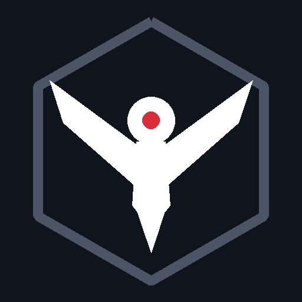
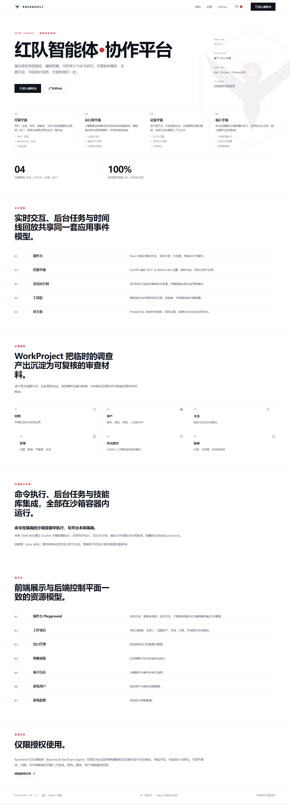
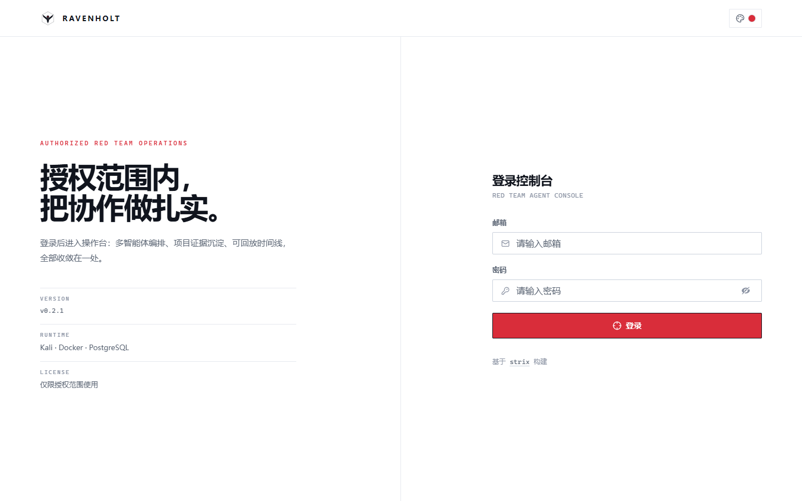
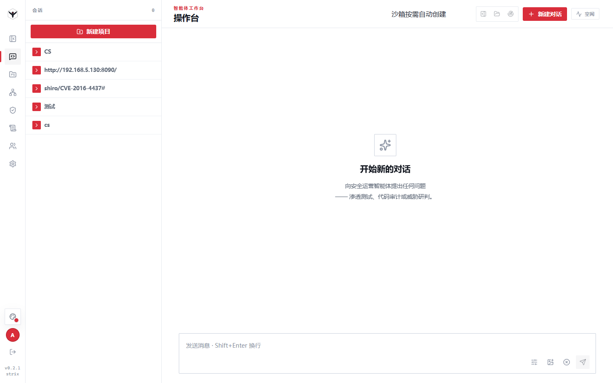
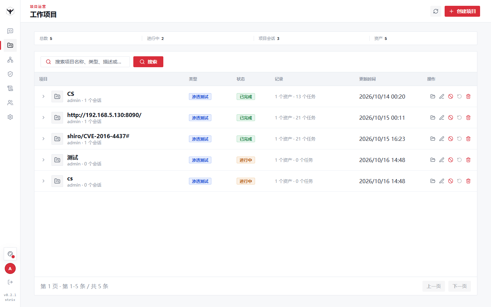
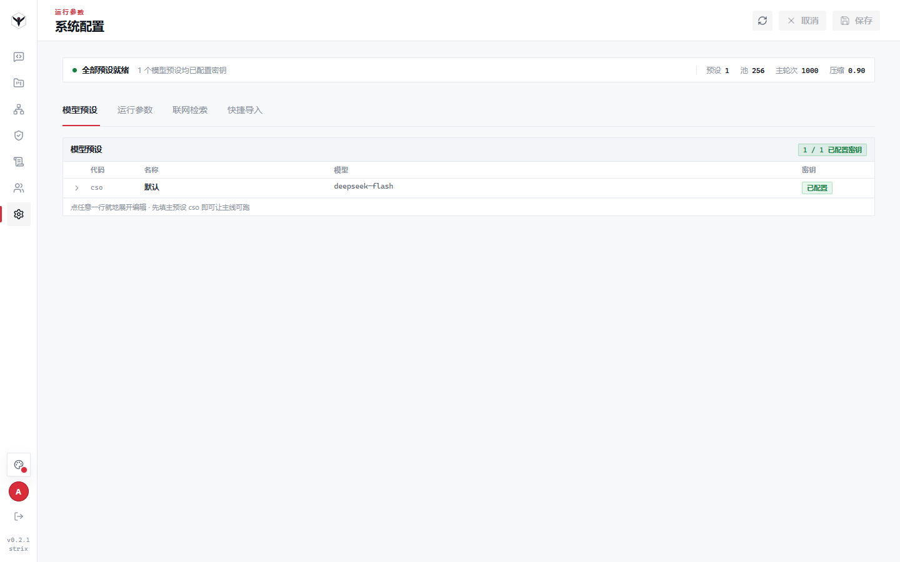
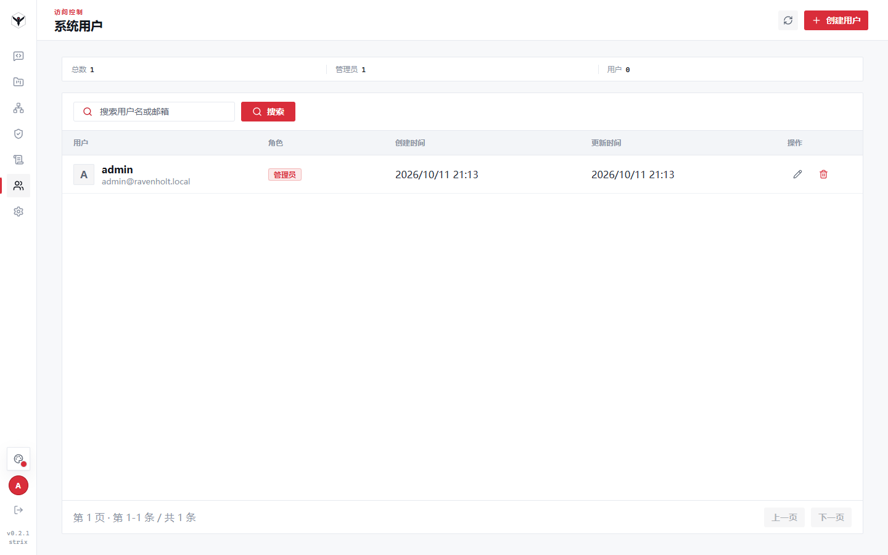
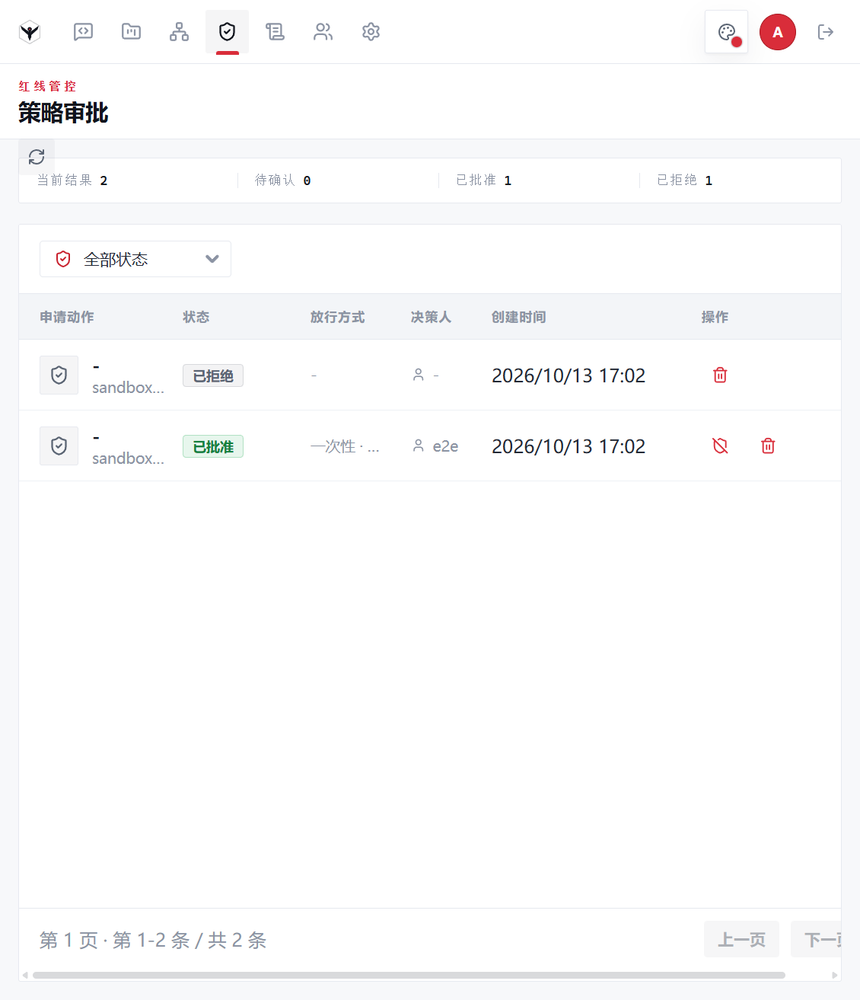
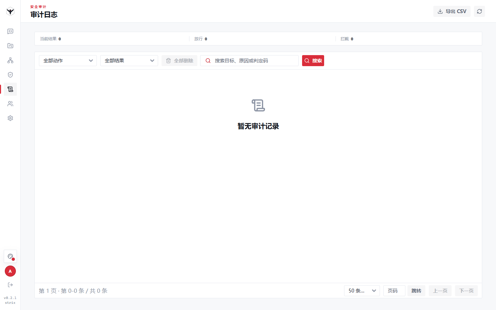
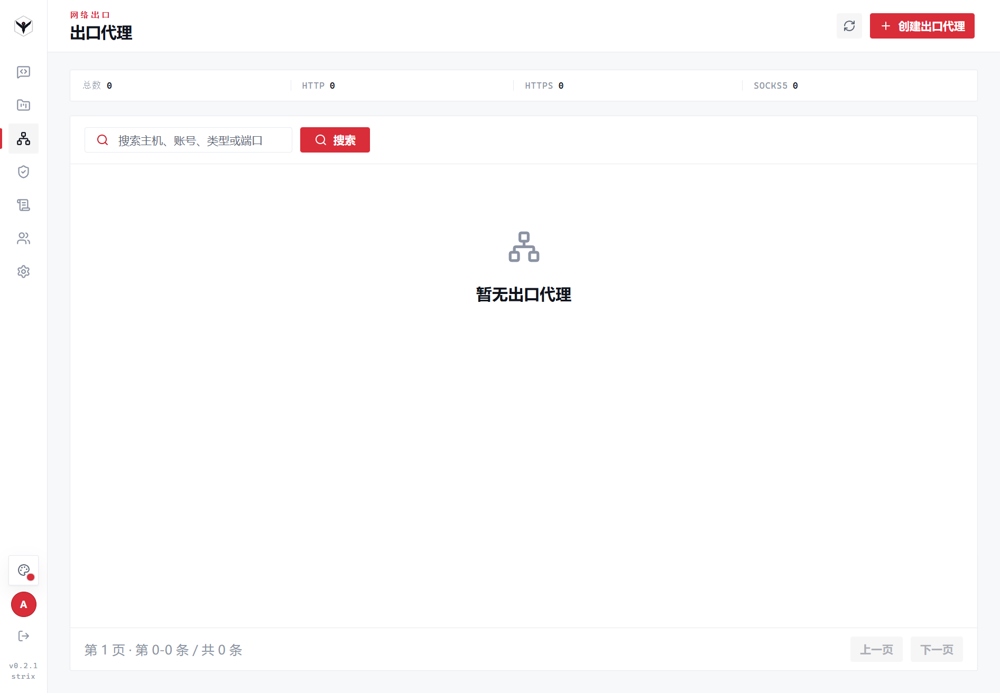

<div align="center">



# Ravenholt · Red-Team Multi-Agent Collaboration Platform

> An open-source, authorization-scoped red-team multi-agent platform for penetration testing, vulnerability discovery, code auditing, and security research

<a href="https://github.com/xiaoliuhua2/ravenholt"></a>
<a href="./LICENSE"></a>
<a href="https://xiaoliuhua2.github.io/ravenholt/"></a>
<a href="./CHANGELOG.md"></a>

<br/>



[中文](./README.md) · **English** · [Online docs](https://xiaoliuhua2.github.io/ravenholt/)

</div>

---

> [!WARNING]
> **Authorized use only.** This project may be used for security testing, risk assessment, code auditing, and research **only within a legally authorized scope for which you hold explicit written permission**.
> It does not, and must not, grant any right to test, scan, access, or affect any unauthorized third-party system, network, service, account, or data. Unauthorized testing is illegal in most jurisdictions.
> **The authors are not responsible for any misuse or the damages it causes.**

---

## Table of Contents

1. [Overview](#1-overview)
2. [Features](#2-features)
3. [Architecture](#3-architecture)
4. [Requirements & Full Dependency List](#4-requirements--full-dependency-list)
5. [Download & Installation](#5-download--installation)
6. [Configuration](#6-configuration)
7. [Running & Operations](#7-running--operations)
8. [Getting Started](#8-getting-started)
9. [UI Gallery](#9-ui-gallery)
10. [Project Layout](#10-project-layout)
11. [FAQ](#11-faq)
12. [License](#12-license)

---

## 1. Overview

Ravenholt is a **control-plane-oriented** red-team multi-agent platform: it turns agent-assisted security work into a **governed, reviewable** engineering process. Conversations are not the only source of truth — project scope, assets, findings, relationship graphs, attack paths, replayable timelines, and the agent's own reasoning process are all persisted as explicit application data.

At its core it uses [strix](https://github.com/usestrix/strix) as the penetration-testing execution engine (vendored in this repository, verified by `.strix-vendor.json`), and layers a control plane, a policy-governance layer, and an evidence plane on top of it:

| Part | Role |
| --- | --- |
| **strix runtime** (vendored) | Execution engine: agent orchestration, skill library, sandbox toolchain, Caido capture, reporting |
| **Control plane** (this repo) | Unified entry point for sessions / projects / users / hosts / system config; REST + WebSocket, permission and resource boundaries |
| **Policy governance & evidence plane** | Red-line policy (fail-closed), action approvals, audit log, WorkProject evidence, replayable timeline |
| **All-in-one sandbox image** | `sandbox-runtime:latest`, built by this repo's `sandbox/`: upstream capabilities (Caido + Kali toolchain) plus the customized toolchain (Ghidra / Jadx / observer_ward / agent-browser), an in-container control plane, and skill resources |

### 1.1 Relationship to upstream strix

**strix is this project's execution engine, not a competitor.** The entire strix source tree is vendored into `strix/` (431 files), and the platform **does not modify its package-internal runtime logic** — the design constraint is "assembly and adaptation only", so the upstream can be followed at any time. `.strix-vendor.json` records the upstream repository, commit, per-file SHA-256 hashes and a protected prefix (`skills/src_hunt/`) for verification and upgrade alignment.

**In one sentence:** strix is a single-machine CLI / TUI pentest agent; ravenholt is a control-plane-oriented red-team multi-agent **platform** — the same agent runtime, placed inside an engineering process that has sessions, projects, evidence, policy and audit.

| Dimension | Upstream strix | ravenholt (this repo) |
| --- | --- | --- |
| Interaction | CLI / terminal TUI / its own viewer (reads local run dirs) | Web console (REST + WebSocket): sessions, projects, policy, audit, container console |
| Execution engine | Ships its own agent runtime, skills, sandbox, Caido | **Reused** (the same vendored code); the platform injects model config and run context at the assembly layer |
| Model wiring | strix's own settings / LiteLLM resolution | Platform per-agent config (the `agents` section) injected, without touching strix internals |
| Sessions | One run (a single scan) | Multiple sessions: interrupt / cancel / resume, session pool, background sub-agent tasks with wake-up |
| Orchestration | In-process root agent spawning | Platform-side `AgentCoordinator` + mailbox collection + a graph view (child completion reports return to the parent) |
| Process record | Report files (markdown / SARIF) | **WorkProject**: scope assets, findings, relationship graph, attack paths, replayable timeline |
| Evidence | The agent's own narrative is the conclusion | **Differential evidence + an independent verifier**: the platform replays baseline / probe, and only `reproduced` may leave the draft state |
| Governance | None | **Red-line policy (fail-closed) + approval queue + audit log + egress proxies** |
| Sandbox | Upstream image (Caido + Kali toolchain) | The same base image plus reverse-engineering tools, an in-container Go control plane, a desktop stack, and in-container skill resources |
| Web search | Exa / Perplexity | Adds **a local SearXNG (zero-config) and DeepSeek**; `auto` ranks by availability and fails over |
| Skills | Upstream skill library | The same loader plus registered image skills and **deterministic skill routing** (`route_skills`) |
| Where the additions live | — | `core/` `service/` `router/` `schema/` `model/` `web/` `sandbox/`; `strix/` stays upstream-clean |

> The two can coexist: `strix/` is both the engine source and the alignment baseline for upgrades (`scripts/verify_strix_version_alignment.py`).

---

## 2. Features

### 2.1 Feature → Prerequisite Matrix

The table below states, for every feature, what it requires and where to enable it. Following [8.2 Enabling the full capability set](#82-enabling-the-full-capability-set) in order turns everything on.

| Feature | Requires | How to enable |
| --- | --- | --- |
| Login, users & roles, system config | PostgreSQL + config files | `bash setup.sh` handles it |
| Playground sessions (streaming chat with agents) | **LLM API key** (OpenAI-compatible endpoint) | Fill it on the System Config page, or `bash config-tool.sh set ...` |
| **Pentest / audit execution** inside sessions (sandbox) | Docker + a sandbox image | The upstream image (~4 GB) is pulled automatically on the first session; after building the all-in-one image, sessions use the customized toolchain instead |
| Platform **sandbox container** console<br/>(terminal / file manager / noVNC) | `sandbox-runtime:latest` + an image record | `cd sandbox && bash build.sh`, then add a record on the Sandbox Images page (Control Port `8000`) |
| Caido capture / replay / request store | Sandbox execution plane (both images ship it) | Started with the session; no configuration needed |
| Binary reversing (Ghidra / Jadx / apktool / binwalk) | All-in-one image | Takes effect for sessions automatically once `sandbox-runtime:latest` is built |
| Browser automation (agent-browser-cli) | All-in-one image | Same as above |
| Web search (`web_search` / `web_get_contents`) | Local SearXNG **or** Exa / Perplexity key | **Zero config**: the platform auto-starts a local SearXNG container; third-party keys are optional |
| Egress proxy (controlled network egress) | All-in-one image (in-container control plane) + a proxy entry | Build the image, then configure the chain on the Egress Proxies page |
| OOB callback (reverse-shell collection) | macvlan network (host must support it) | `bash serve.sh start` runs `sandbox/setup_macvlan.sh`; falls back to bridge otherwise |
| Work projects / assets / findings / graphs / attack paths | Control plane basics | Available out of the box |
| Source-code audit track (white box) | LLM key + a source archive | Upload the archive inside a project; skill routing and prompts switch automatically |
| Policy approvals (high-risk actions parked for review) | `.ravenholt/policy.yaml` | Generated by `setup.sh`; adjustable live from the console |
| Audit log | `policy.yaml` → `audit.enabled=true` | On by default (Tier-1, cannot be disabled) |
| Replayable timeline | Control plane basics | Available out of the box |
| Full event archive (side-car persistence) | `archive` section of `config.json` | On by default |
| MCP tool integration | MCP server config | Loaded on demand within a session |

> In one line: **the minimum is Python 3.12+ / PostgreSQL / one LLM API key**; **the full capability set adds Docker plus the all-in-one sandbox image**.

### 2.2 Feature Details

- **Playground**: multi-agent sessions, streaming chat, sub-agent panel, inline thinking display, replayable timeline; the session column is drag-resizable and collapsible.
- **Sandbox execution plane**: Docker sandbox containers providing the Kali toolchain, terminal, file manager, noVNC remote view, and Caido capture/replay; provisioned automatically per session.
- **WorkProject**: project metadata, owner, scoped assets, sessions, records, relationship graphs, and attack paths; findings carry evidence and impact.
- **Source-code audit track (white box)**: upload a source archive to switch to the white-box track, with skill routing and prompts adapting accordingly.
- **Egress proxy**: configuration and management of controlled network egress (proxy chains).
- **Policy approvals**: the red-line policy decides whether an action is allowed; high-risk actions enter an approval queue for an administrator to approve/reject.
- **Audit log**: audit trail of critical actions and events (action, decision, blocking reason, etc.).
- **System users / system config**: accounts and role permissions, runtime parameters, and integration config.
- **Replayable timeline**: all sources merged into a single chronological view for post-hoc review, item by item.

---

## 3. Architecture

```
┌──────────────────────────────────────────────┐
│  Frontend console (React 19 + Semi UI + Vite) │
│  Landing · Login · Playground · Projects …    │
└───────────────────────┬──────────────────────┘
                        │ REST + WebSocket
┌───────────────────────▼──────────────────────┐
│  Control plane (FastAPI, /api)                │
│  Users · Sessions · Projects · Policy · Audit │
└───────┬───────────────────────┬──────────────┘
        │                       │
┌───────▼────────┐      ┌───────▼──────────────┐
│ Session runtime│      │ Evidence plane        │
│ strix engine   │      │ assets/findings/graph │
│ dynamic agents │      │ evidence chain        │
└───────┬────────┘      └──────────────────────┘
        │
┌───────▼──────────────────────────────────────┐
│  Sandbox execution plane (Docker, one image)  │
│  Caido · Kali toolchain · Ghidra/Jadx · noVNC │
└───────┬──────────────────────────────────────┘
        │
┌───────▼──────────┐
│  PostgreSQL 16   │
└──────────────────┘
```

| Layer | Technology |
| --- | --- |
| Frontend | React 19, TypeScript, Vite 8, Semi UI, CodeMirror, xterm, Cytoscape, Mermaid |
| Backend | Python 3.13, FastAPI, SQLModel/SQLAlchemy, asyncpg, Uvicorn, WebSocket |
| Execution engine | strix (vendored), Docker sandbox, Caido, Kali toolchain |
| Sandbox image | `sandbox/build.sh` → `sandbox-runtime:latest` (upstream strix image + customized layers) |
| Database | PostgreSQL 16 |
| Deployment | plain venv / Docker Compose |

### Sandbox Execution Plane: One Image, Two Uses

Two things decide all sandbox behavior:

| Aspect | Handled by | What it uses |
| --- | --- | --- |
| **What is inside the container** | The image | By default `ghcr.io/usestrix/strix-sandbox:1.3.0` (upstream: Caido + Kali toolchain); after building, `sandbox-runtime:latest` (all-in-one) |
| **Who creates the container, how commands run** | The platform | Session containers are provisioned on demand by the strix SDK; commands are executed through [service/sandbox/commands.py](service/sandbox/commands.py) via Docker `exec` — **no in-container control plane required** |

Capability comparison:

| Capability | Upstream `strix-sandbox:1.3.0` | All-in-one `sandbox-runtime:latest` |
| --- | --- | --- |
| Caido capture / request store / replay | ✅ | ✅ |
| Kali toolchain (nmap / sqlmap / nuclei / ffuf / katana / httpx / semgrep / trivy / chromium / node / python / uv) | ✅ | ✅ |
| Ghidra / Jadx / apktool / binwalk | ❌ | ✅ |
| observer_ward / agent-browser-cli | ❌ | ✅ |
| In-container Go control plane (terminal / files / noVNC / live egress refresh) | ❌ | ✅ |
| In-container skill resources `.agents/skills` | ❌ | ✅ |
| Desktop stack Xvfb + x11vnc + noVNC, tor | ❌ | ✅ |

**How the all-in-one image is built**: `sandbox/Dockerfile` takes `ghcr.io/usestrix/strix-sandbox:1.3.0` as its **base image** (`FROM ${STRIX_SANDBOX_IMAGE}`) and layers the increments above on top, reusing the upstream `ENTRYPOINT` (`/ravenholt-entrypoint.sh` first detaches the extra services, then `exec`s the upstream script to start Caido) — so nothing upstream is lost.

- **Without building it**: sessions still run on the upstream image (Caido + Kali toolchain), missing only the customized tools and the platform container console.
- **After building it**: `setup.sh --with-sandbox` writes the image name into `config.json`'s `sandbox.image`, so **both** sessions and platform containers use it.
- For a manual deployment, just set `"sandbox": { "image": "sandbox-runtime:latest" }` in `.ravenholt/config.json` (see [6.1](#61-ravenholtconfigjson)).

---

## 4. Requirements & Full Dependency List

> For a first deployment, install 4.1 through 4.4. If you only need "log in and chat", 4.1 is enough.

### 4.1 Core (mandatory)

| Item | Requirement | Verify with |
| --- | --- | --- |
| OS | **Linux x64** (Kali Rolling / Debian recommended) | `uname -m` |
| Python | **≥ 3.12** (3.13 recommended), with `venv` | `python3 -V` |
| PostgreSQL | **16+**, service running | `psql --version`, `pg_isready` |
| LLM API key | OpenAI-compatible endpoint (DeepSeek / OpenAI / self-hosted) | — |
| Network | Reachable PyPI and npm mirrors, LLM endpoint | `curl -I https://pypi.org` |
| Disk | ≥ 2 GB (platform + frontend artifacts) | `df -h .` |

### 4.2 Full-Feature Dependencies (by capability)

| Component | Version / size | Provides | Consequence of skipping |
| --- | --- | --- | --- |
| **Docker** | 24+, daemon running | Sandbox execution plane (in-session command execution, Caido capture) | Control plane only; no pentesting |
| **All-in-one sandbox image** | `sandbox-runtime:latest` (~5 GB+ to build) | Ghidra/Jadx/apktool/binwalk/observer_ward/agent-browser, container console, live egress refresh, skill resources | Sessions still run on the upstream image, but the items above are missing |
| **Upstream sandbox image** | `ghcr.io/usestrix/strix-sandbox:1.3.0` (~4 GB) | Caido + Kali toolchain | Pulled automatically on the first session; pre-pull for offline hosts |
| **Node.js** | ≥ 20.19 (22 recommended) | **Building the frontend (required for source deployments)**: the repo does not ship `web/dist-app`; run `npm install && npm run build` to produce it | Without it the console pages cannot load (Docker/Compose deployments build it inside the image, so no host Node.js is needed) |
| **Docker Compose** | v2 | The Compose deployment route | No impact if you use `serve.sh` |
| **SearXNG container** | `searxng/searxng:latest` (~265 MB) | Zero-config web search | Auto-started by the platform; offline hosts should use Exa/Perplexity keys |
| **macvlan support** | Host NIC allows multiple L2 MACs | Target-initiated callbacks (OOB exfil / reverse-shell collection) | Falls back to bridge; OOB uses the in-container interactsh |
| **JRE** | Bundled in the all-in-one image (`openjdk-21-jdk-headless`) | Running Ghidra / Jadx | Nothing to install when using the all-in-one image |

### 4.3 System Packages

`setup.sh` installs the following automatically; install them manually for a hand-rolled deployment. Note **Node.js comes from the official binary** (extracted into `/usr/local`, avoiding the distro's older build) and **Docker comes from the distro package and has its daemon started automatically**.

| Purpose | Packages |
| --- | --- |
| Running the platform | `python3`, `python3-venv`, `python3-pip` |
| Database | `postgresql`, `postgresql-client` |
| Basics | `curl`, `openssl`, `ca-certificates`, `git` |
| Sandbox runtime | `docker.io` (plus `systemctl enable --now docker`) |
| Frontend build | Node.js 22.x, official binary (the script downloads it into `/usr/local`; override the source/version with `NODE_MIRROR` / `NODE_VERSION`) |

> The system packages the all-in-one sandbox image needs (apktool, binwalk, 7zip, make, sqlite3, openjdk-21-jdk-headless, xvfb, x11vnc, novnc, websockify, tor, supervisor, ...) are declared in `sandbox/Dockerfile` and installed by `docker build` — they do **not** need to be installed on the host.

### 4.4 Python & Frontend Dependencies

| Source | Content |
| --- | --- |
| `requirements.txt` | All backend dependencies (FastAPI, SQLModel, asyncpg, docker, openai-agents[litellm], caido-sdk-client, jinja2, pydantic, ...) |
| `web/package.json` | Frontend dependencies (React 19, Semi UI, Vite 8, CodeMirror, xterm, Cytoscape, Mermaid, ...), installed only when rebuilding the frontend |

### 4.5 Port Reference

| Port | Purpose | Default binding |
| --- | --- | --- |
| `8000` | Control-plane HTTP + WebSocket; the **in-sandbox** Go control plane also listens on 8000 | `0.0.0.0` (host) / in-container |
| `5432` | PostgreSQL | `127.0.0.1` (published to the host under Compose) |
| `8888` | Local SearXNG (web-search backend) | `0.0.0.0`, narrowable via `searxng_bind_addr` |
| `5433` | pgAdmin (Compose stack only) | `0.0.0.0` |
| `30000–60999` | Control proxy of platform sandbox containers (allocated dynamically) | On demand |
| `48080` | Caido proxy inside sandbox containers | In-container |
| `5900` / `8080` | x11vnc / noVNC inside sandbox containers (all-in-one image) | In-container |

> If you deploy on an internet-reachable host, narrow SearXNG's binding (see [6.5](#65-web-search-configuration)) and consider a firewall or reverse proxy in front of the control plane.

---

## 5. Download & Installation

### 5.1 Get the source

```bash
git clone https://github.com/xiaoliuhua2/ravenholt.git
cd ravenholt
```

> You can also download and unzip the repository. It vendors the complete `strix/` runtime (431 files), **but the frontend build output `web/dist-app` is not committed**: source deployments must build the frontend once (see Step 5 in 5.3, Node ≥ 20.19); Docker / Compose deployments generate it during the image build.

### 5.2 One-click deployment (full feature set, recommended)

```bash
# 1) Check first: inspect the environment without touching any file
bash setup.sh --check

# 2) Full deployment: env check -> system deps -> config init -> database
#    -> Python deps -> frontend build -> all-in-one sandbox image -> self-check
#    (--with-sandbox also builds sandbox-runtime:latest, required for the full set)
bash setup.sh --with-sandbox

# 3) Just prepare the runtime (installs Node.js / Docker) and do the rest later:
bash setup.sh --deps-only     # installs system deps, then exits
bash setup.sh --no-deps       # the opposite: skip system deps and Node.js / Docker
```

The script runs 8 stages and prints results per stage:

| Stage | Content |
| --- | --- |
| 1/8 Env check | OS/arch/Python/Node/Docker/PostgreSQL/permissions/ports/disk, each with a verdict and a fix command |
| 2/8 System deps | Installs what's missing (apt); **also installs Node.js (official binary 22.x) and Docker (installs it and starts the daemon)**, then re-checks hard requirements such as Python/venv |
| 3/8 Config init | Generates `.ravenholt/config.json` (random `encrypt_key`, DB password, admin password) and **`policy.yaml`** |
| 4/8 PostgreSQL | Starts the service, creates role and database, with credentials aligned to config.json |
| 5/8 Python deps | Creates `.venv` and runs `pip install -r requirements.txt` |
| 6/8 Frontend build | `npm install --include=optional` + `npm run build` under `web/`, producing `web/dist-app`; if it fails on a missing optional native binding (Vite 8's rolldown platform binding), it **self-heals in two steps**: (1) re-install optionals and retry; (2) if that still fails, parse the missing binding name out of the build log and explicitly install `@rolldown/binding-<platform>` at rolldown's actual version, then retry (measured: `--include=optional` alone usually does not restore it; step 2 is what works) |
| 7/8 Sandbox image | Checks whether the upstream image has been pulled; builds the all-in-one image with `--with-sandbox` and **writes `sandbox.image` into config.json on success** |
| 8/8 Post-install self-check | Syntax compile, config/policy loading, `create_app` assembly smoke test |

The script is **idempotent**: an existing `config.json` / `policy.yaml` is never overwritten, and `sandbox.image` is left alone once set.

> [!TIP]
> **Every download and long-running step reports live progress, so nothing looks frozen**: apt (`Get` / `Setting up` lines), the Node.js binary (`already downloaded X.XX MB (N s)`, refreshed every second), pip, `npm install` and `npm run build` (`running… N s` heartbeat, full logs in `.npm-install.log` / `.build.log`), and Ghidra / Jadx inside the sandbox image build (downloaded MB refreshed every 3 seconds, with automatic resume and 5 retries). **To tell whether it is really stuck, watch whether that number still grows** — only a number that stays flat for a long time means a network or mirror problem (see the slow-download entry in [11 FAQ](#11-faq)).

> [!IMPORTANT]
> The admin password is randomly generated and printed **only once** — save it immediately.
> If you lose it, delete `.ravenholt/config.json` and re-run `bash setup.sh` (this regenerates the DB password too, so update the database role accordingly).

> [!NOTE]
> `--with-sandbox` builds the all-in-one image (~5 GB; needs network access to download Ghidra / Jadx / observer_ward). **Skipping it does not block pentesting**: sessions pull the upstream image (~4 GB) automatically, missing only the customized tools and the platform container console.

### 5.3 Manual, step by step

For environments where you want to control every step.

**Step 1: System dependencies**

```bash
sudo apt update
sudo apt install -y python3 python3-venv python3-pip \
                    postgresql postgresql-client \
                    curl openssl ca-certificates git
# Node.js (needed to build the frontend; pick either route — route A matches what setup.sh does)
# Route A: official binary into /usr/local (avoids the distro's older build)
curl -fsSL https://nodejs.org/dist/v22.11.0/node-v22.11.0-linux-x64.tar.xz \
  | sudo tar -xJ -C /usr/local --strip-components=1
# Route B: the nodesource repo
curl -fsSL https://deb.nodesource.com/setup_22.x | sudo -E bash - && sudo apt install -y nodejs
# Docker (required for the full feature set)
sudo apt install -y docker.io && sudo systemctl enable --now docker
```

Verify: `python3 -V` (≥3.12), `node -v` (≥20.19), `psql --version`, `docker info`.

**Step 2: Database**

```bash
sudo systemctl start postgresql
sudo -u postgres psql -c "CREATE USER root WITH PASSWORD 'your-db-password';"
sudo -u postgres psql -c "CREATE DATABASE ravenholt OWNER root;"
```

> The password must match `database.password` in `config.json` from step 3.

**Step 3: Config files (critical, don't skip)**

```bash
cp .ravenholt/config.json.example .ravenholt/config.json
cp .ravenholt/policy.yaml.example .ravenholt/policy.yaml
```

- `.ravenholt/config.json`: edit `system.encrypt_key` (≥32 random chars, mandatory), `system.bootstrap_admin` (admin email and a strong password), `database`, and `agents.*` (LLM `api_key` / `base_url` / `model`).
- `.ravenholt/policy.yaml`: the **red-line policy; the platform treats it as fail-closed** — a missing file, invalid YAML, or failed validation makes the platform **refuse to start**. The `enabled` flags of `rate_limit`, `sandbox`, `kill_switch`, and `audit` must be `true`.
- `.ravenholt/skill_routes.yaml` (**optional**): instance override layer for skill routing. When absent, factory defaults are used (`core/strix_runtime/skill_routes.default.yaml`).

**Step 4: Python dependencies**

```bash
python3 -m venv .venv
source .venv/bin/activate
pip install --upgrade pip
pip install -r requirements.txt
```

**Step 5: Build the frontend (required for source deployments)**

```bash
cd web && npm install --include=optional && npm run build && cd ..
# If it still reports MODULE_NOT_FOUND (missing rolldown platform binding):
#   read the binding name out of the error (e.g. linux-x64-gnu) and install it
#   explicitly at rolldown's own version:
#   rd_ver=$(node -p "require('rolldown/package.json').version")
#   npm install --no-save "@rolldown/binding-linux-x64-gnu@$rd_ver"
#   npm run build
```

> **Required for source deployments**: `web/dist-app` is build output and is not committed; without it the API works but console pages fail to load (blank / 404). Docker / Compose deployments build it inside the image — no host Node.js needed.

**Step 6: Build the all-in-one sandbox image (required for the full feature set)**

```bash
cd sandbox && bash build.sh      # produces sandbox-runtime:latest (x64 only)
cd ..
```

Then make **both sessions and platform containers** use it — set in `.ravenholt/config.json`:

```json
"sandbox": {
    "network": "ravenholt-lan",
    "image": "sandbox-runtime:latest"
}
```

and add a record on the console's **Sandbox Images** page (`image_name` = `sandbox-runtime:latest`, `Control Port` = `8000`) before you can create containers with terminal/file/noVNC on the Sandbox Containers page.

> With `sandbox.image` empty, sessions use the upstream `ghcr.io/usestrix/strix-sandbox:1.3.0` (pulled on first use).

**Step 7: Start**

```bash
bash serve.sh start              # background service (recommended)
# or run in the foreground for debugging:
bash serve.sh run
```

Open <http://127.0.0.1:8000>.

### 5.4 Docker Compose deployment

For running the control plane and the database together in containers.

```bash
# Prerequisites: 1) .ravenholt/config.json and .ravenholt/policy.yaml are ready
#                   (a missing or invalid policy.yaml makes the platform fail closed and the container won't start)
#                2) the all-in-one image sandbox-runtime:latest is built on the HOST
#                   (the app container does not contain the sandbox/ directory)
docker compose -f docker-compose.prod.yml up -d --build
```

> The app image is built **in stages** by the root `Dockerfile`: a Node stage runs `npm ci && npm run build` to produce the frontend, which is copied into the runtime image — so the repo does **not** need to contain `web/dist-app`, and the host does **not** need Node.js. The image also contains the vendored `strix/` runtime; `./.ravenholt` is mounted into the container as runtime config; `app` uses sandbox images through the mounted host Docker socket.

> [!TIP]
> **Slow or failing builds on restricted networks**: the `Dockerfile` accepts two **optional** mirror arguments (defaults are unchanged — omit them to use the official sources):
> `--build-arg PIP_INDEX_URL=<PyPI mirror>` (e.g. `https://mirrors.aliyun.com/pypi/simple/`)
> and `--build-arg NPM_REGISTRY=<npm mirror>` (e.g. `https://registry.npmmirror.com`).
>
> ```bash
> docker build --build-arg PIP_INDEX_URL=https://mirrors.aliyun.com/pypi/simple/ \
>              --build-arg NPM_REGISTRY=https://registry.npmmirror.com \
>              -t ravenholt:latest .
> ```
>
> `docker compose ... up -d --build` cannot pass build args directly — build the app image manually first, or set the same arguments under `build.args` in the compose file.

> [!CAUTION]
> **Where Compose gets its config (important)**: the bundled `postgres` service uses the fixed password `123456` (see `docker-compose.prod.yml`), matching the repo's `.ravenholt/config.json.example`. For Compose, **copy the example directly**:
>
> ```bash
> cp .ravenholt/config.json.example .ravenholt/config.json
> cp .ravenholt/policy.yaml.example .ravenholt/policy.yaml
> ```
>
> **Do not reuse the `config.json` generated by `bash setup.sh` (5.2)**: that script generates a **random** database password, which will not match Compose's fixed `123456`; the app then cannot reach the database and fails to start.

The stack contains three services:

| Service | Description |
| --- | --- |
| `app` | Builds image `ravenholt:latest`; `network_mode: host`; mounts `./.ravenholt` and `/var/run/docker.sock` (to create sandbox containers) |
| `postgres` | `postgres:16-alpine`, data in `./.postgres-data` |
| `pgadmin` | <http://127.0.0.1:5433> for graphical database access |

> Note: `app` uses host networking and mounts the Docker socket (it needs to create sandbox containers) — use it only on a trusted host.
> For development you can also start just the database with `docker compose -f docker-compose.dev.yml up -d`.

### 5.5 Post-install verification

Run these in order; if all pass, the full feature set is ready:

```bash
# 1) Service up, health check passing
bash serve.sh status

# 2) Database reachable
psql -h 127.0.0.1 -U root -d ravenholt -c '\dt' | head

# 3) Sandbox images present (sandbox-runtime for the full set, strix-sandbox to run sessions)
docker images | grep -E 'strix-sandbox|sandbox-runtime'

# 4) Sessions are actually configured to use the all-in-one image (should read sandbox-runtime:latest)
grep -A3 '"sandbox"' .ravenholt/config.json

# 5) Web-search backend reachable
curl -s -o /dev/null -w '%{http_code}\n' http://127.0.0.1:8888/

# 6) Image and code versions aligned (especially after upgrading the vendor)
.venv/bin/python scripts/verify_strix_version_alignment.py
```

Open <http://127.0.0.1:8000> and log in with the admin email and password — installation done.

---

## 6. Configuration

### 6.1 `.ravenholt/config.json`

| Section | Key fields | Notes |
| --- | --- | --- |
| `system` | `listen_addr` / `listen_port` | Control-plane listen address and port (the example uses `0.0.0.0:8000`) |
| | `encrypt_key` | Data encryption key — **must be changed** to a ≥32-char random string |
| | `bootstrap_admin` | Admin auto-created on first start (`enabled` / `username` / `email` / `password`); log in with the email |
| `database` | `host` / `port` / `database` / `username` / `password` | PostgreSQL connection; use `127.0.0.1` for a local deployment |
| | `pool_size` / `max_overflow` / `pool_timeout_seconds` / `pool_recycle_seconds` / `pool_pre_ping` | Connection-pool parameters |
| `agents` | `cso` … | Per-agent LLM config: `api_key` / `base_url` / `model` / `use_responses` / `context_window`; the agent list comes from this section |
| `agent_pool` | `max_size` / `ttl_seconds` / `sweep_interval_seconds` | In-process agent session pool |
| `agent_runtime` | `main_max_turns` / `subordinate_max_turns` / `model_stream_idle_timeout_seconds` / `context_compression_*` | Turn limits and context compaction |
| `sandbox` | `network` | Custom Docker network for sandbox containers (e.g. `ravenholt-lan`). Empty => default bridge + port publishing; non-empty => derived and injected as `STRIX_DOCKER_SANDBOX_NETWORK` by `sandbox/setup_macvlan.sh` |
| | `image` | **Image used by session sandboxes.** Empty = upstream `ghcr.io/usestrix/strix-sandbox:1.3.0`; `sandbox-runtime:latest` = the all-in-one image (customized toolchain included) |
| `archive` | `enabled` / `capture_*` / `retention_days` / `queue_max`, etc. | Side-car archiving of the event bus |
| `integrations` | `web_search_provider` | Web-search backend: `auto` / `exa` / `perplexity` / `searxng` |
| | `exa_api_key` / `perplexity_api_key` | Third-party search keys (may be left empty) |
| | `searxng_base_url` | Self-hosted SearXNG URL, default `http://127.0.0.1:8888` |
| | `searxng_auto_provision` | Whether to auto-start the SearXNG container when unreachable; on by default |
| | `searxng_bind_addr` | Host address the SearXNG container publishes its port on; default `0.0.0.0` |

> **SearXNG and public deployments**: on startup the platform best-effort starts a local SearXNG container (`searxng_auto_provision`, on by default) and publishes its port on `0.0.0.0` by default (`searxng_bind_addr`) — so that both macvlan sandboxes (via the host LAN IP) and bridge-fallback sandboxes (via the docker gateway `172.17.0.1`) can search through it. The service is **unauthenticated** (`limiter: false`, `public_instance: false`); if the platform runs on a host directly reachable from the internet, set `searxng_bind_addr` to `127.0.0.1` (giving up in-sandbox direct access) or to the host's internal IP, or restrict the source via the host firewall — otherwise it can be abused as an open search proxy.

> Config changes take effect after a restart: `bash serve.sh restart`.

### 6.2 `.ravenholt/policy.yaml` (red-line policy, fail-closed)

- **A missing file, invalid YAML, or failed validation makes the platform refuse to start** — by design.
- `rate_limit`, `sandbox`, `kill_switch`, and `audit` are Tier-1 safety nets whose `enabled` must be `true` (their parameters are freely tunable).
- `approvals` defines "not done by default, requires your consent" actions (password change, destructive operations, payload execution, target data mutation, logout/revoke, CORS probing, privilege writes); `redline.dos_signals` is the **absolute red line** — DoS-class matches are hard-rejected, and the console offers no override switch.
- `approval_wait_seconds` controls how long an approval card waits; on timeout the action is treated as **rejected** (fail-closed).
- `report_gate` is the report structure gate: a finding must meet minimum elements (bound asset, title/description length, impact statement) before leaving draft.
- Changes made in the console **take effect immediately and are written back to this file** (rewritten wholesale, comments folded); manual edits require a restart.

### 6.3 Environment variables

The platform injects the following variables that strix reads (normally you never set them by hand):

| Variable | Source | Effect |
| --- | --- | --- |
| `STRIX_LLM` / `LLM_API_KEY`, etc. | `agents` section | Model and key handed to LiteLLM |
| `STRIX_WEB_SEARCH_PROVIDER` / `EXA_API_KEY` / `PERPLEXITY_API_KEY` / `STRIX_SEARXNG_BASE_URL` | `integrations` section | Web-search backend and keys |
| `STRIX_DOCKER_SANDBOX_NETWORK` | `sandbox.network` | Docker network sandbox containers join |
| `STRIX_IMAGE` | `sandbox.image` | **Image used by session sandboxes**; when empty nothing is injected and strix falls back to its upstream default |

Switches you may export yourself:

| Variable | Default | Effect |
| --- | --- | --- |
| `RAVENHOLT_SEARXNG_AUTOPROVISION=0` | on | Disables the SearXNG auto-provision guarantee (takes precedence over the config field) |
| `SANDBOX_CONTAINER_NAME_PREFIX` | `ravenholt-sandbox` | Container-name prefix for platform sandboxes; an empty string falls back to the image short name |
| `SANDBOX_COMMAND_WORKDIR` | `/workspace` | Working directory for in-sandbox commands (use it when the two images' WORKDIRs differ) |

> A manual `export STRIX_IMAGE=...` is overridden by `sandbox.image` (config wins), so prefer editing the config file.

### 6.4 Managing LLM API keys

```bash
bash config-tool.sh list                                  # show a summary of every agent config
bash config-tool.sh set sk-xxxx --url https://api.deepseek.com/v1 --model deepseek-v4-flash
bash config-tool.sh clear                                 # clear all keys
```

You can also fill them in on the console's **System Config** page; the two are equivalent.

### 6.5 Web-search configuration

| provider | Requires | Notes |
| --- | --- | --- |
| `searxng` (zero-config default) | No key | The platform auto-starts a local SearXNG container (with image-mirror fallbacks) |
| `exa` | `exa_api_key` | Apply on your own |
| `perplexity` | `perplexity_api_key` | Apply on your own |
| `auto` | Nothing | Tries `exa → perplexity → searxng` in order and uses whichever is available |

To reach the local SearXNG from inside a sandbox, use the **host LAN IP** (e.g. `http://192.168.5.139:8888`), not `127.0.0.1`: sandbox containers have their own IP, so `127.0.0.1` points at the container itself. Also note that all in-sandbox egress goes through the Caido proxy, so an unreachable target returns a ~9 KB `<title>Caido</title>` error page — that is the proxy reporting a failure, not the target's response.

### 6.6 Sandbox image: build and enable

```bash
cd sandbox && bash build.sh        # produces sandbox-runtime:latest
# switch the base image (e.g. a regional mirror):
# docker build --build-arg STRIX_SANDBOX_IMAGE=<image> -t sandbox-runtime:latest .
# switch the GitHub accelerator prefix (default https://gh-proxy.com/; empty = direct):
# GITHUB_MIRROR=https://ghfast.top/ bash build.sh
# GITHUB_MIRROR= bash build.sh
```

> [!TIP]
> **When bandwidth is insufficient**: the build downloads ~1.5 GB of Ghidra plus several tool packages. If your link is very slow (measured environments get only tens of KB/s through the accelerator — 1.5 GB takes hours and gets cut off by the proxy), build the image on a well-connected machine and migrate it:
>
> ```bash
> # on the well-connected machine
> docker save sandbox-runtime:latest | gzip > sandbox-runtime.tgz
> # on the target machine
> gunzip -c sandbox-runtime.tgz | docker load
> ```
>
> Not building it at all is also fine: sessions fall back to the upstream image `ghcr.io/usestrix/strix-sandbox:1.3.0` (Caido + Kali toolchain), lacking only the reverse-engineering tools and the container console.

Enabling requires **two** places (both are needed, for different purposes):

| Purpose | Where | What to set |
| --- | --- | --- |
| agent **session** sandbox | `.ravenholt/config.json` → `sandbox.image` | `sandbox-runtime:latest` |
| Platform **sandbox container** console | Console → Sandbox Images page (new record) | `image_name` = `sandbox-runtime:latest`, `Control Port` = `8000` |

After changing `sandbox.image`, restart (`bash serve.sh restart`); only **new** sessions pick up the new image (running sessions are unaffected).

---

## 7. Running & Operations

```bash
bash serve.sh start      # background service (default action; PID file, port health check, logs to disk)
bash serve.sh run        # foreground (debug; prints the admin account and password, Ctrl+C to stop)
bash serve.sh status     # show process / port / health check
bash serve.sh logs 40    # show startup log (-f to follow)
bash serve.sh restart    # restart
bash serve.sh stop       # stop (graceful SIGTERM)
```

> [!TIP]
> On start (`serve.sh start` / `run`) the platform reads the admin email and password from `.ravenholt/config.json` and prints them for the first login; if `bootstrap_admin` is disabled it says so instead.

- Application log: `.ravenholt/app.log`
- Service log: `logs/serve.log`
- URL: <http://127.0.0.1:8000>; API docs: <http://127.0.0.1:8000/docs>
- `serve.sh start` also: starts PostgreSQL using the detected major version, creates the venv and installs dependencies if missing, and runs `sandbox/setup_macvlan.sh` to prepare the sandbox network.

---

## 8. Getting Started

### 8.1 First login

1. Open <http://127.0.0.1:8000> and log in with the admin email and password.

   

2. Go to **System Config** and fill in the `agents` LLM API key (or set it beforehand with `config-tool.sh set`) — **this is what makes agents able to work**.

### 8.2 Enabling the full capability set

Follow these in order to turn everything on:

| Step | Action | Result |
| --- | --- | --- |
| 1 | `bash setup.sh --with-sandbox` (or walk through steps 1–6 of 5.3 manually) | Platform, database, frontend, and the all-in-one sandbox image are in place |
| 2 | Confirm `.ravenholt/config.json`'s `sandbox.image` = `sandbox-runtime:latest` | Sessions use the customized image (Ghidra/Jadx/observer_ward/agent-browser) |
| 3 | Add a record on the Sandbox Images page (`Control Port` = `8000`) | Sandbox Containers page can create containers with terminal/file/noVNC |
| 4 | Fill in the LLM API key (System Config page) | Session chat and agent execution work |
| 5 | Create a **Work Project** and fill in scope and objectives | Assets, findings, evidence, and attack paths have a home |
| 6 | Start your first session | A sandbox container (with Caido) is created automatically; images are pulled on demand |
| 7 | Confirm `curl http://127.0.0.1:8888/` returns 200 | Web search works (no key needed) |
| 8 | (Optional) Configure proxy chains on the Egress Proxies page | Sandbox egress becomes controllable and auditable |
| 9 | (Optional) Review `policy.yaml`'s `approvals` / `redline` | Approval thresholds and absolute red lines match your expectations |

### 8.3 A typical pentest flow

1. Create a Work Project and fill in the authorized scope (domains/IPs).
2. Open a new session in the Playground, pick an agent preset, describe the objective.
3. The agent provisions a sandbox container and runs reconnaissance inside it (nmap / httpx / katana, ...); traffic is captured into Caido.
4. Inspect terminal output in the container panel and review captured messages with the **request store** (`list_requests` / `view_request` / `repeat_request`).
5. When a high-risk action is hit, **Policy Approvals** parks it until you click approve in the session.
6. Findings land in the project (with evidence and impact); at the end export the report and cross-check the **replayable timeline** and the **audit log**.

---

## 9. UI Gallery

| Playground | Work Projects |
| --- | --- |
|  |  |

| System Config | System Users |
| --- | --- |
|  |  |

| Policy Approvals | Audit Log |
| --- | --- |
|  |  |

| Egress Proxies | Landing |
| --- | --- |
|  |  |

---

## 10. Project Layout

```
ravenholt/
├── app.py / main.py / config.py / database.py    # app assembly, entry point, config, database
├── core/            # runtime core: agents, session pool, policy engine, strix runtime, event archive
├── service/ handler/ router/ schema/ model/       # layers: logic / handling / routing / contracts / models
├── middleware/ utils/                             # auth, unified responses, middleware and helpers
├── strix/           # vendored strix runtime and skill library (upstream commit + per-file hashes in .strix-vendor.json)
├── .strix-vendor.json  # vendor manifest: upstream repo / commit / file hashes / protected prefix
├── sandbox/         # all-in-one sandbox image build
│   ├── Dockerfile           # upstream image + customized layers
│   ├── entrypoint.sh        # detaches extra services, then hands off to the upstream entrypoint for Caido
│   ├── supervisord.conf     # Xvfb / x11vnc / noVNC / tor / Go control plane
│   ├── proxy/               # in-container Go control plane (terminal/files/egress)
│   ├── .agents/skills/      # in-container skill resources (shipped with the image)
│   └── setup_macvlan.sh     # sandbox network (derived from the host)
├── web/             # frontend sources (src / openapi.json); dist-app is build output, not committed
├── docs/            # VitePress docs site (en / zh)
├── scripts/         # tooling and self-check scripts (sync_strix.py for upstream sync, export_schema, verify_*_selftest, verify_strix_version_alignment, ...)
├── tests/           # unit tests
├── .ravenholt/      # runtime config: config.json / policy.yaml / skill_routes.yaml (never committed)
├── setup.sh         # one-click deployment script
├── serve.sh         # service management (start/stop/restart/status/logs/run; prints account on start)
├── config-tool.sh   # LLM API key management
├── docker-compose.prod.yml / .dev.yml
└── requirements.txt
```

---

## 11. FAQ

**Q: It exits right after starting, and the log mentions policy errors?**
A: `.ravenholt/policy.yaml` is missing or invalid. The platform treats the red-line policy as **fail-closed**, so it must exist and be valid:
`cp .ravenholt/policy.yaml.example .ravenholt/policy.yaml`.

**Q: Can it run without Docker?**
A: Yes — the platform and control plane start fine (login, projects, policy, audit, reports all work), but the **pentest/code-audit sandbox execution plane is unavailable**; you only notice when you start a session.

**Q: Can I pentest without building `sandbox-runtime:latest`?**
A: Yes. Session sandboxes use the upstream image `ghcr.io/usestrix/strix-sandbox:1.3.0` by default (Caido + Kali toolchain), pulled automatically on the first session. Building the all-in-one image adds Ghidra / Jadx / apktool / binwalk / observer_ward / agent-browser, in-container skill resources, and the terminal / file / noVNC features of the Sandbox Containers page.

**Q: I built the image — how do I make agent sessions use it?**
A: `bash setup.sh --with-sandbox` writes the image name into `.ravenholt/config.json`'s `sandbox.image` automatically. For a manual deployment, set `"image": "sandbox-runtime:latest"` yourself and run `bash serve.sh restart`. **Building without configuring leaves sessions on the upstream image.** You also need a record on the Sandbox Images page (`Control Port` = `8000`) to use the Sandbox Containers page.

**Q: Why register the image in two places?**
A: They serve different purposes — `sandbox.image` in `config.json` selects the image for **agent sessions**; the Sandbox Images page record selects the image for **containers you create by hand** (and needs `Control Port` to reach the in-container control plane).

**Q: On the Sandbox Containers page, the terminal / file / noVNC buttons are missing?**
A: That container's image lacks the in-container Go control plane (e.g. the upstream image). Containers created from `sandbox-runtime:latest` are the ones that have those buttons.

**Q: Will sandboxes still work after changing subnets / moving to another LAN?**
A: Yes. `sandbox/setup_macvlan.sh` hard-codes no network range — subnet, gateway, parent interface, container address range, and host shim address are all derived from the host's default route, so after a network change a restart (`bash serve.sh restart`) rebuilds everything.

**Q: Cannot create sandbox containers?**
A: Confirm the Docker daemon is running and that the platform process can reach the Docker socket (Compose mounts `/var/run/docker.sock`).

**Q: The all-in-one image build fails?**
A: Two cases. **(1) It fails while resolving images** (`failed to resolve source metadata for docker.io/docker/dockerfile:1`, `connection refused`, `registry-1.docker.io` timeouts) — the host cannot reach Docker Hub / GHCR, and this image needs `debian:trixie-slim` and `golang:trixie` (Docker Hub) plus `ghcr.io/usestrix/strix-sandbox` and `ghcr.io/astral-sh/uv` (GHCR). Fixes: configure a registry mirror for Docker (`registry-mirrors` in `/etc/docker/daemon.json`, e.g. `https://docker.m.daocloud.io`) then `systemctl restart docker`; verify connectivity with `docker pull ghcr.io/usestrix/strix-sandbox:1.3.0`; if fully offline, build on a connected machine and migrate with `docker save` / `docker load`. (This repo's `sandbox/Dockerfile` deliberately omits `# syntax=docker/dockerfile:1` so that no extra frontend image has to be pulled.) **(2) It fails mid-build** — confirm x64 architecture and sufficient disk (it downloads ~1.5 GB of Ghidra and more), and on restricted networks use `--build-arg STRIX_SANDBOX_IMAGE=<reachable-mirror>`. `sandbox/build.sh` prints these steps when the build fails.

**Q: Inside a sandbox, `curl` to a target returns 502 with a `Caido` title?**
A: That is a **proxy error page, not the target's response** — all in-sandbox egress goes through the container's Caido proxy, which answers on behalf of an unreachable target. Use `curl -s <url> | grep -A8 'c-title"'` to see the real cause (`Failed to query DNS` / `Connection refused` / TLS handshake failure / timeout), then fix the URL and retry.

**Q: Config changes don't take effect?**
A: `config.json` changes need a restart (`bash serve.sh restart`), and `sandbox.image` only affects **sessions created afterwards**; `policy.yaml` changes via the console are live, manual edits need a restart. Changes to an agent's `approvals.allow` only apply to newly created sessions / new sub-agents (prompts are rendered when the agent is created).

**Q: After `git clone`, the browser shows a blank page or 404?**
A: The frontend output `web/dist-app` is **not committed**, so source deployments must build it first: `cd web && npm install && npm run build` (Node ≥ 20.19). Docker / Compose deployments generate it during the image build.

**Q: `npm run build` fails?**
A: Most often the Node version (< 20.19), or a **missing optional native binding** — Vite 8's rolldown needs its platform binding (e.g. `@rolldown/binding-linux-x64-gnu`), and the error reads `Cannot find module '../rolldown-binding.<platform>.node'`. **Measured: `npm install --include=optional` usually does not restore it** (the entry already exists in `package-lock.json`, so npm sees nothing to do). What works is installing the binding package **explicitly at rolldown's actual version**:

```bash
cd web
rd_ver=$(node -p "require('rolldown/package.json').version")
npm install --no-save --prefer-offline "@rolldown/binding-linux-x64-gnu@$rd_ver"
npm run build
```

`setup.sh` step 6/8 already does both (re-install optionals first, then parse the binding name from the build log and install it by version). If both fail, switch npm registry (`npm config set registry https://registry.npmmirror.com`) or delete `web/node_modules` and reinstall.

**Q: The page still shows old content?**
A: Pages such as the landing page are **frozen at build time** — after changing sources you must re-run `cd web && npm run build` and hard-refresh the browser (Ctrl+F5).

**Q: After Compose deployment, app cannot reach the database?**
A: Most likely you reused the `config.json` generated by `setup.sh` (random DB password), which does not match Compose's fixed `123456`. See the config-source note in [5.4](#54-docker-compose-deployment).

**Q: What should I watch out for when deploying on the public internet?**
A: Three things — ① narrow `searxng_bind_addr` (that service is unauthenticated); ② the control plane listens on `0.0.0.0:8000`, so put a reverse proxy with TLS and access control in front; ③ sandbox containers require the Docker socket, so host networking should only be used on a trusted host.

---

## 12. License

This project is released under the **MIT License**, copyright 2026 `yv1ing` and `xiaoliuhua2`. See [LICENSE](./LICENSE).

The vendored strix runtime retains its original license and copyright notices (Apache-2.0). The all-in-one sandbox image **redistributes** third-party binaries at runtime (Ghidra / Jadx / observer_ward / agent-browser-cli / the Kali toolchain, ...); comply with each of their licenses when deploying or redistributing it. Before testing anything with this platform, make sure you hold explicit authorization for the target.
