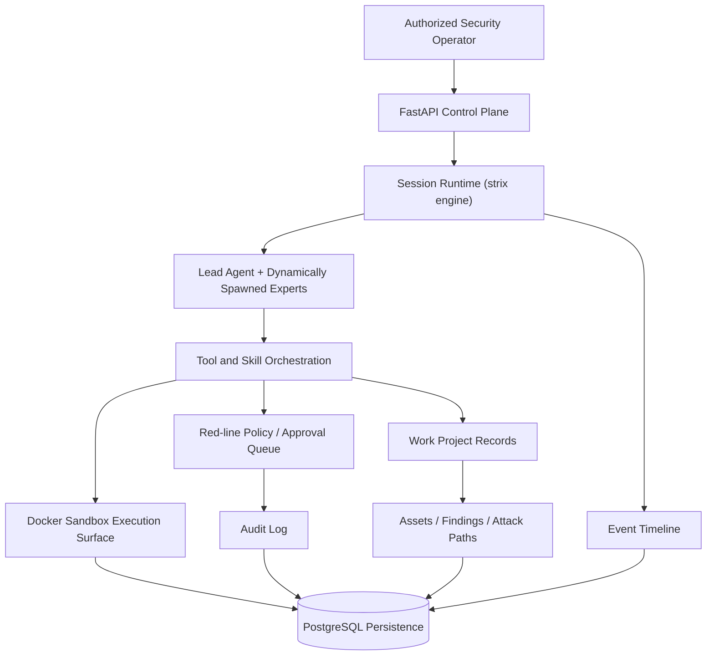
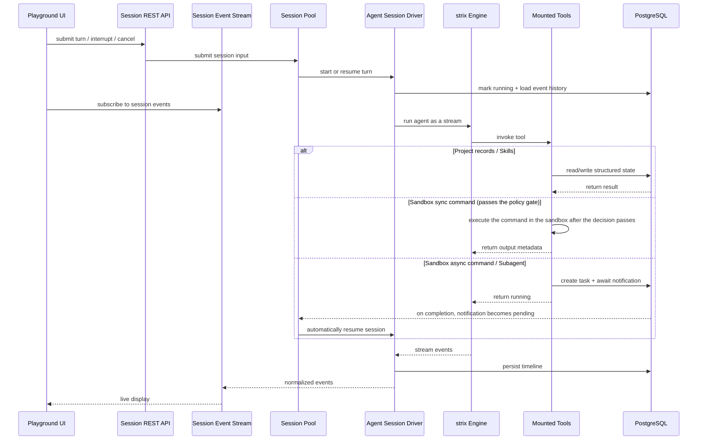

# Overview

Ravenholt is an open-source **red team agent collaboration platform** that uses [strix](https://github.com/usestrix/strix) as its penetration execution engine (vendored into the repository, see `.strix-vendor.json`) and layers a control plane, a policy governance layer, and an evidence surface on top of it, targeting authorized penetration testing, vulnerability discovery, code auditing, and security research.

During task execution, the system continuously accumulates assets, relationships, vulnerability findings, and attack paths into structured evidence that can be retained long-term; high-risk actions are intercepted by the **red-line policy** and enter approval, while key actions are written to the **audit log**, giving security work better observability, auditability, and reproducibility.

> :warning: Security Notice
>
> This project is intended only for security testing, risk assessment, and academic research within legal and explicitly authorized scopes. It must not be used for unlawful, unauthorized, or destructive purposes, including but not limited to unauthorized intrusion into computer systems or theft of others' data.
>
> This project does not grant permission to test, access, scan, or affect any third-party systems, networks, services, accounts, or data.
>
> **The author is not responsible for any consequences, losses, damages, legal liabilities, or unlawful behavior caused by users.**

## Relationship to upstream strix

The execution engine is [strix](https://github.com/usestrix/strix); its source tree is vendored into the repository's `strix/` directory (431 files). The platform **does not modify strix's package-internal runtime logic** (assembly and adaptation only) and records the upstream commit plus per-file hashes in `.strix-vendor.json`, so the upstream can be followed and aligned at any time.

In one sentence: **strix is a single-machine CLI / TUI pentest agent; ravenholt is a control-plane-oriented red-team multi-agent platform** — the same agent runtime, placed inside an engineering process with sessions, projects, evidence, policy, and audit.

| Dimension | Upstream strix | ravenholt |
| --- | --- | --- |
| Interaction | CLI / terminal TUI / its own viewer | Web console (sessions / projects / policy / audit / container console) |
| Sessions | One run (a single scan) | Multiple sessions: interrupt / cancel / resume, session pool, background subagent tasks with wake-up |
| Orchestration | In-process root agent spawning | Platform `AgentCoordinator` + mailbox collection + a graph view |
| Process record | Report files (markdown / SARIF) | WorkProject: assets / findings / relationship graph / attack paths / replayable timeline |
| Evidence | The agent's own narrative is the conclusion | Differential evidence + an independent verifier (replays baseline/probe; only `reproduced` may leave the draft state; the reporting tool can also carry a replay package through the same gate) |
| Governance | None | Red-line policy (fail-closed) + approval queue + audit log + egress proxies |
| Sandbox | Upstream image (Caido + Kali toolchain) | All-in-one image: reverse-engineering tools, in-container Go control plane, desktop stack, skill resources |
| Web search | Exa / Perplexity | Adds a local SearXNG (zero-config) and DeepSeek, with automatic failover |

> For installation steps and "what each feature requires", see the repository's `README.md` ("1. Overview" and "5. Download & Installation"). Note: the frontend build output `web/dist-app` is not committed — source deployments must build the frontend once.

## Core Capabilities

| Capability | Description |
| --- | --- |
| Multi-agent red team orchestration | The lead agent **dynamically spawns** expert agents per task, breaking intelligence, vulnerabilities, analysis, and path planning into subtasks that can be carried out in parallel. |
| Session-level runtime | Each session runs independently, supporting interruption, cancellation, recovery, and continuous execution. |
| Background subagent tasks | Subagents can run persistently as background tasks and wake the parent agent on completion for result integration and follow-up planning. |
| Asynchronous sandbox task system | Long-running commands execute as asynchronous tasks with persisted state, preventing tool execution from blocking the main workflow. |
| Controlled sandbox execution environment | Docker-based custom sandbox containers provide command execution, file access, a web terminal, noVNC remote view, and Caido capture/replay; containers are provisioned automatically per session. |
| Proxy egress isolation | Sandbox containers can bind HTTP/HTTPS/SOCKS5 proxy egress (including Tor) to reduce exposure of the operator environment. |
| Project-oriented red team workflow | WorkProject centrally manages project scope, assets, vulnerability findings, relationship graphs, and attack paths so the process remains easier to trace and review. |
| Red-line policy and approvals | The policy makes **fail-closed** decisions on high-risk actions; actions requiring human confirmation enter the approval queue, where an administrator approves or rejects them. |
| Audit log | Records key actions and events (action, decision, block reason, raw command) to support after-the-fact review. |
| Source code auditing channel (white-box) | After uploading a source package you can switch to the white-box track, and skill routing and runtime conventions switch accordingly. |
| Evidence chain and independent validation | A finding must carry reproducible evidence before it can be set to confirmed; an independent validator rules via "replay + four-dimensional diff". |
| Replayable event timeline | Conversations, tool calls, subtasks, errors, and result events are continuously recorded for real-time display and historical replay. |

## Architecture

The architecture uses FastAPI as the control plane to centrally manage sessions, projects, policies, and execution resources. The core runtime is session-driven, organizing the lead agent and expert agents through **dynamic spawning**, while the tool and skill orchestration layer connects sandbox execution, project records, and the event timeline. The Docker sandbox provides an isolated execution environment for authorized security testing; the red-line policy decides at the tool execution boundary whether to allow or route to approval, the audit log records key actions, and WorkProject precipitates assets, vulnerability findings, and attack paths into traceable and reviewable project evidence. PostgreSQL persists session state, task progress, vulnerability findings, asset relationships, attack paths, and replayable events underneath.

## Agents

Agents are **not** a fixed, static roster: the list is determined by the project configuration (the `agents` section of `.ravenholt/config.json`) and contains only a lead preset (`cso`) by default; during execution the runtime **dynamically spawns** expert agents per task and no longer depends on a hard-coded expert roster.

## Runtime Sequence

