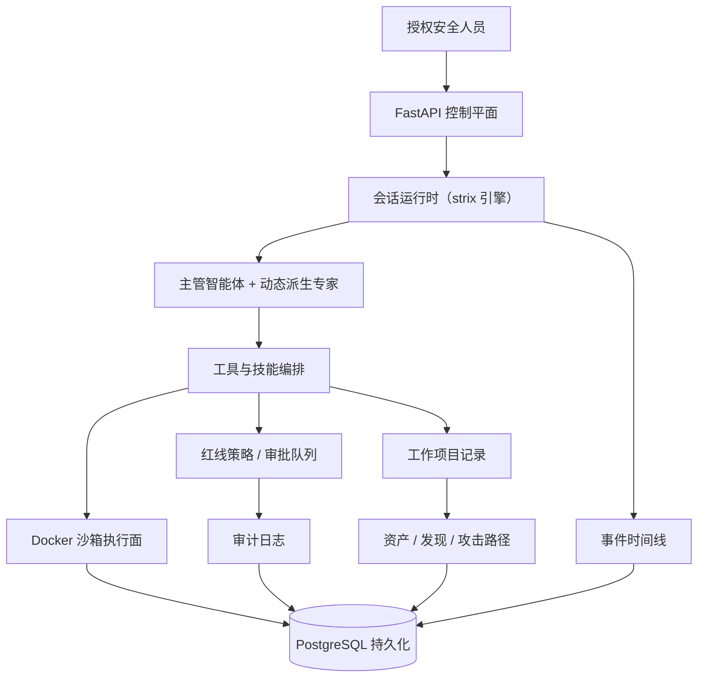
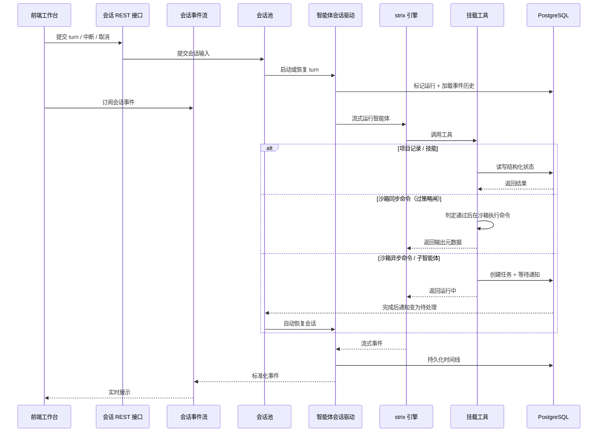

# 概览

Ravenholt 是一个开源的**红队智能体协作平台**，以 [strix](https://github.com/usestrix/strix) 作为渗透执行引擎（已 vendor 进仓库，见 `.strix-vendor.json`），并在其上叠加控制平面、策略治理层与证据面，面向授权渗透测试、漏洞挖掘、代码审计与安全研究。

任务执行过程中，系统会持续沉淀资产、关系、漏洞发现与攻击路径，形成可长期留存的结构化证据；高风险动作由**红线策略**拦截并进入审批，关键动作写入**审计日志**，使安全工作具备更好的可观察性、可审计性和可复现性。

> :warning: 安全声明
>
> 本项目仅限在合法且获得明确授权的范围内用于安全测试、风险评估和学术研究，严禁用于任何违法、未授权或具有破坏性的用途，包括但不限于非法入侵计算机系统、窃取他人数据等行为。
>
> 本项目不授予任何测试、访问、扫描或影响第三方系统、网络、服务、账号或数据的权限。
>
> **作者不对使用者造成的任何后果、损失、损害、法律责任或违法行为负责。**

## 与上游 strix 的关系

执行引擎是 [strix](https://github.com/usestrix/strix)，源码已整份 vendor 进仓库的 `strix/` 目录（431 个文件）；平台**不修改其包内运行时逻辑**（只做装配与适配），并用 `.strix-vendor.json` 记录上游 commit 与逐文件哈希，便于随时跟随上游升级与对齐。

一句话：**strix 是「单机 CLI / TUI 渗透 agent」，ravenholt 是「以控制平面为中心的红队多智能体协作平台」**——同一套 agent 运行时，被放进带会话、项目、证据、策略与审计的工程流程里。

| 维度 | 上游 strix | ravenholt |
| --- | --- | --- |
| 形态 | CLI / 终端 TUI / 自带 viewer | Web 控制台（会话 / 项目 / 策略 / 审计 / 容器控制台） |
| 会话 | 一次 run（单次扫描） | 多会话：中断 / 取消 / 恢复、会话池、后台子智能体任务与唤醒 |
| 编排 | 进程内 root agent 派生 | 平台 `AgentCoordinator` + 邮箱回收 + 可视图谱 |
| 过程沉淀 | 报告文件（markdown / SARIF） | WorkProject：资产 / 发现 / 关系图 / 攻击路径 / 可回放时间线 |
| 证据 | agent 自述即结论 | 差分级证据 + 独立验证器（重放 baseline/probe 裁决，`reproduced` 才可离开草稿态；报告工具也可随报告携带请求包走同一闸门） |
| 治理 | 无 | 红线策略（fail-closed）+ 审批队列 + 审计日志 + 出口代理 |
| 沙箱 | 上游镜像（Caido + Kali 工具链） | 一体化镜像：叠加逆向工具、容器内 Go 控制面、桌面栈、技能资源 |
| 联网检索 | Exa / Perplexity | 扩展本机 SearXNG（零配置）与 DeepSeek，失败时自动降级 |

> 安装步骤与「完整功能需要什么」见仓库根目录的 `README.md`（「一、项目简介」与「五、下载与安装部署」）。注意：前端产物 `web/dist-app` 不入库，源码部署须先构建一次前端。

## 核心能力

| 能力 | 说明 |
| --- | --- |
| 多智能体红队编排 | 主管智能体按任务**动态派生**专家智能体，将情报、漏洞、分析与路径梳理拆解为可并行推进的子任务。 |
| 会话级运行时 | 每个会话独立运行，支持中断、取消、恢复与连续执行。 |
| 后台子智能体任务 | 子智能体可作为后台任务持久运行，并在完成后唤醒父智能体进行结果整合与后续规划。 |
| 异步沙箱任务系统 | 长时间运行的命令以异步任务执行并持久化状态，避免工具执行阻塞主流程。 |
| 受控沙箱执行环境 | 基于 Docker 的定制沙箱容器，提供命令执行、文件访问、网页终端、noVNC 远程画面与 Caido 抓包/重放；容器按会话自动 provision。 |
| 代理出口隔离 | 沙箱容器可绑定 HTTP/HTTPS/SOCKS5 代理出口（含 Tor），降低操作者环境暴露风险。 |
| 项目化红队工作流 | 通过 WorkProject 统一管理项目范围、资产、漏洞发现、关系图谱与攻击路径，使过程更易追踪和审查。 |
| 红线策略与审批 | 策略对高风险动作做 **fail-closed** 判定；需人工确认的动作进入审批队列，由管理员批准或拒绝。 |
| 审计日志 | 记录关键动作与事件（动作、判定、拦截原因、命令原文），支持事后复核。 |
| 源码审计通道（白盒） | 上传源码包后可切换到白盒分轨，技能路由与运行时口径随之切换。 |
| 证据链与独立验证 | 发现必须携带可复现证据方可置为已确认；独立验证器以「重放 + 四维差分」裁决。 |
| 可回放事件时间线 | 持续记录对话、工具调用、子任务、错误和结果事件，支持实时展示与历史回放。 |

## 项目架构

该架构以 FastAPI 作为控制平面，统一管理会话、项目、策略与执行资源。核心运行时由会话驱动，通过**动态派生**组织主管智能体与专家智能体，并由工具与技能编排层连接沙箱执行、项目记录与事件时间线。Docker 沙箱为授权安全测试提供隔离执行环境；红线策略在工具执行边界处判定放行或转审批，审计日志记录关键动作；WorkProject 则将资产、漏洞发现和攻击路径沉淀为可追踪、可复盘的项目证据。底层通过 PostgreSQL 持久化会话状态、任务进度、漏洞发现、资产关系、攻击路径与回放事件。

## 智能体

智能体**不是**固定的静态角色表：列表由项目配置（`.ravenholt/config.json` 的 `agents` 段）决定，默认只含一条主管预设（`cso`）；执行时由运行时按任务**动态派生**专家智能体，不再依赖预先写死的专家名单。

## 运行时序

